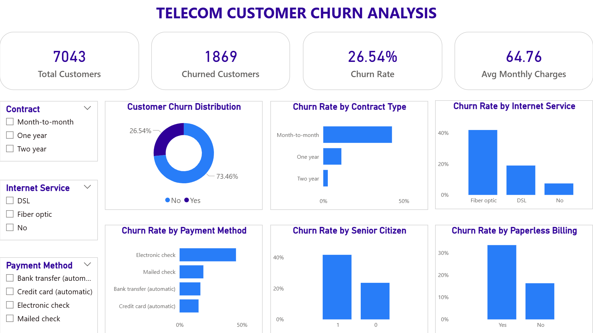

# **Project Type:** Personal Project
# Telecom Customer Churn Analysis

## Project Overview

Why are customers leaving a telecom company, and which customers should the business focus on retaining?

This project analyzes **7,043 customer records** to identify customer groups with higher churn rates and understand the patterns associated with customer loss.

Using Python, MySQL, and Power BI, I cleaned the data, analyzed customer behavior, and developed an interactive dashboard to communicate the findings.

## Business Problem

The business needed to understand which customers were more likely to leave and where to focus its retention efforts.

The analysis focused on customer contracts, tenure, payment methods, internet services, and other customer characteristics.

## Project Objectives

- Measure overall customer churn.
- Identify customer groups with higher churn rates.
- Understand patterns related to customer tenure, contracts, services, and payments.
- Present findings through an interactive dashboard.
- Recommend practical customer retention actions.

## My Role

This was my personal project. I independently handled data preparation, exploratory analysis, SQL queries, dashboard development, and business recommendations.

## Tools & Technologies

| Tool | Purpose |
|---|---|
| Python (Pandas, NumPy) | Data cleaning and analysis |
| Matplotlib, Seaborn | Data visualization |
| MySQL | Customer churn analysis using SQL |
| Power BI | Interactive dashboard |
| Jupyter Notebook | Python development |

## Analysis Workflow

1. **Data Understanding:** Examined 7,043 records and 21 columns to understand customer and service information.
2. **Data Cleaning:** Investigated 11 blank `TotalCharges` values. All belonged to zero-tenure customers, so they were converted to zero. No duplicate records were found.
3. **Exploratory Analysis:** Used Python to compare churn across customer groups.
4. **SQL Analysis:** Calculated churn rates and customer metrics across contracts, services, payment methods, and customer characteristics.
5. **Dashboard Development:** Built a Power BI dashboard to present the main findings.

## Key Findings

| Customer Segment | Churn Rate |
|---|---:|
| Month-to-month contracts | **42.71%** |
| Electronic check users | **45.29%** |
| Fiber Optic customers | **41.89%** |
| Customers without TechSupport | **41.64%** |
| Customers without OnlineSecurity | **41.77%** |
| Senior customers | **41.68%** |

**Overall churn:** 1,869 customers (26.54%) had left the company, while 5,174 (73.46%) remained.

**Tenure finding:** Customers who left had an average tenure of 17.98 months, compared with 37.57 months for customers who stayed.

## Dashboard Preview



*The dashboard summarizes customer churn and compares churn rates across contract, internet service, payment method and customer groups.*

**Power BI file:** [Download Customer_Churn_Analysis.pbix](PowerBI/Customer_Churn_Analysis.pbix)

## What I Achieved

Identified customer groups with higher churn, including month-to-month contract customers, fiber-optic users and electronic-check users. These findings provide a basis for prioritizing customer segments for further investigation and retention efforts.

## Business Recommendations

Based on these findings, the business could:

- Offer suitable longer-term contract options to month-to-month customers.
- Improve onboarding and engagement during the early months of a customer's relationship.
- Review the payment experience for electronic check users and explain automatic payment options.
- Investigate pricing, service quality, and customer feedback among Fiber Optic customers.
- Review support-service needs and the value offered to higher-charge customers.

These are proposed actions, not measured improvements in customer retention.

## Challenges & Solutions

**Challenge:** The `TotalCharges` column contained 11 blank values.

**Solution:** I checked the affected customer records and found that all had zero tenure. I converted the blank values to zero instead of deleting the records or using an arbitrary replacement.

## Limitations

- The analysis identifies patterns and relationships; it does not prove the causes of churn.
- Customer feedback and service complaint data were not available to explain why customers left.
- The recommended actions have not been implemented or tested, so their impact is unknown.

## Future Enhancements

- Include customer feedback and complaint data.
- Compare churn patterns over different time periods.
- Evaluate the results of future retention campaigns.
- Develop a customer-level churn risk report.

## Project Structure

```text
Customer-Churn-Analysis/
│
├── Dataset/
│   ├── Raw/
│   │   └── WA_Fn-UseC_-Telco-Customer-Churn.csv
│   └── Processed/
│       └── Customer_Churn_Cleaned.csv
│
├── Python/
│   ├── 01_Data_Loading.ipynb
│   ├── 02_Data_Cleaning.ipynb
│   └── 03_EDA_Visualization.ipynb
│
├── SQL/
│   └── Customer_Churn_Analysis.sql
│
├── PowerBI/
│   └── Customer_Churn_Analysis.pbix
│
├── Reports/
│   └── Dashboards/
│       └── Customer_Churn_Dashboard.png
│
├── README.md
├── Business_Insights.md
├── Data_Dictionary.md
├── Cleaning_Log.md
└── Requirements.txt
```

## How to View the Project

- **Python:** Open the notebooks in Jupyter Notebook and run them in numerical order.
- **SQL:** Open the SQL script in MySQL Workbench, create the database and table, import the cleaned dataset, and execute the queries.
- **Power BI:** Download and open the `.pbix` file using Power BI Desktop.

## Conclusion

The analysis identified customer groups with higher churn rates, particularly month-to-month customers, electronic check users, and Fiber Optic customers.

These findings provide a starting point for the business to investigate customer needs and plan more focused retention activities.